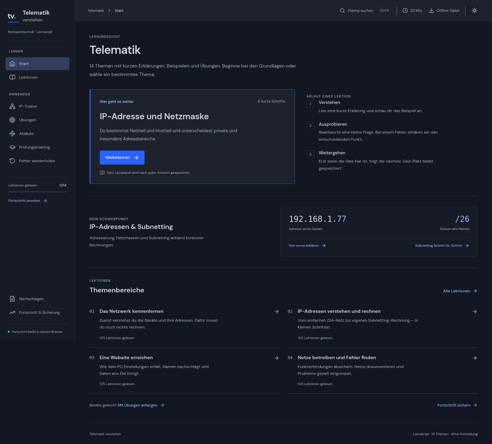

<div align="center">

# Telematik verstehen

Eine Lernanwendung für Netzwerktechnik: geführte Lektionen, IPv4-Trainer und Übungen. Desktoporientiert, mit Hell-/Dunkelmodus und lokal gespeichertem Lernfortschritt.


</div>

## Öffnen: keine Installation nötig

Zum Lernen brauchst du **kein Node.js und kein Terminal**. Verwende den Website-Link oder die fertige HTML-Datei.

### Mit einem Link

Die vorgesehene Adresse ist **https://uncryptobull.github.io/study-website-bbc/**. Sie funktioniert erst nach der Veröffentlichung über GitHub Pages; der Live-Status ist noch nicht bestätigt. Falls du eine 404-Seite siehst, nutze vorerst die Datei. Die Veröffentlichung ist in [docs/ACCESS.md](docs/ACCESS.md) beschrieben.

### Nur die fertige Datei herunterladen

1. Öffne [Telematik-verstehen.html auf GitHub](https://github.com/uncryptobull/study-website-bbc/blob/main/Telematik-verstehen.html).
2. Klicke rechts über der Datei auf **Download raw file** (Download-Symbol). Falls GitHub nur **Raw** zeigt, öffne es und speichere die Datei als **Telematik-verstehen.html**.
3. Öffne die heruntergeladene **Telematik-verstehen.html** mit Edge, Chrome oder Firefox. Die ganze Lernanwendung ist darin enthalten.

### Wenn du bereits das GitHub-ZIP heruntergeladen hast

1. Entpacke das ZIP vollständig: Rechtsklick auf die ZIP-Datei → **Alle extrahieren**.
2. Öffne den entpackten Projektordner.
3. Öffne **Telematik-verstehen.html**. Verwende **nicht `index.html`**: Das ist die Startdatei für die Entwicklung und benötigt einen Entwicklungsserver. Sie zeigt deshalb einen Hinweis mit einem Link zur fertigen Datei.

Falls Windows das ZIP blockiert: Rechtsklick auf das ZIP → **Eigenschaften** → **Zulassen/Blockierung aufheben**, sofern diese Option angezeigt wird, dann erneut entpacken. Einfacher ist der direkte Download der einzelnen HTML-Datei oben. Auf verwalteten Schulgeräten können lokale HTML-Dateien durch Richtlinien gesperrt sein; verwende dann die veröffentlichte Website oder frage die zuständige IT. [Weitere Hinweise zu Zugang und Sicherungen](docs/ACCESS.md).



Weitere Ansichten: [Hellmodus](docs/dashboard.png) · [Interaktive Aufgaben](docs/exercises.png).

## Funktionen

- **14 Themen in 59 Schritten lernen:** Geräte und Adressen zuerst, dann Binärzahlen, IPv4 und Subnetting. Jeder Schritt enthält eine Erklärung, ein Beispiel und eine kurze Verständnisfrage. Bei Fehlern wird der entscheidende Punkt erklärt.
- **IPv4 verstehen:** Adressen, Masken und Bits live verändern; Netzadresse, Broadcast und Hostbereich nachvollziehen. `/31` und `/32` werden als Sonderfälle behandelt.
- **Selbst ausprobieren:** Binärtrainer, beidseitiger Netzvergleich und FLSM-Aufteilung.
- **Interaktiv verstehen:** 28 Aufgaben zu allen 14 Themen: zuordnen, Abläufe ordnen, Entscheidungen treffen und Bits schalten. Hinweise und Erklärungen helfen beim nächsten Versuch.
- **Prüfungsfragen üben:** 70 feste Fragen, neu generierte Subnetting-Aufgaben, Hinweise, begründetes Feedback und Fehlerwiederholung bleiben separat verfügbar.
- **Prüfungstraining machen:** Eine gemischte Runde mit einer Frage pro Thema und anschliessender Auswertung.
- **Zusammenhänge ausprobieren:** Schrittweise Abläufe für DHCP, DNS und Websiteaufrufe sowie eine bearbeitbare Routingtabelle und PAT-Zuordnungen.
- **Fortschritt behalten:** Der genaue Lektionsschritt bleibt nach einem Reload erhalten. JSON-Sicherungen, Hell-/Dunkelmodus, Tastaturbedienung und Fokus-Timer sind eingebaut. Version 1.2.0 überarbeitet den Hellmodus mit neutralen Flächen, deutlichen Eingabefeldern und klaren Auswahlzuständen.

Keine Anmeldung, API-Schlüssel oder Backend-Dienste. Die Anwendung lädt keine externen Schriften oder Video-Player; Quellen und Videos öffnen nur nach einem Klick.

Der Lernstand bleibt im Browser. Die produktive App sperrt ausgehende Datenanfragen und übermittelt keinen Referrer. Hinweise zu Hosting, Sicherungen und öffentlichem Quellcode stehen in [docs/PRIVACY.md](docs/PRIVACY.md).

## Offline-Datei und Lernstand

Zum Lernen brauchst du keine Entwicklungswerkzeuge. Die fertige **Telematik-verstehen.html** enthält die ganze App. Auf einer gehosteten Version kannst du sie mit **Offline-Datei** rechts oben speichern. Antworten und Fortschritt werden nicht in die weitergegebene HTML-Datei eingebettet; eine separate Sicherung lässt sich in der App exportieren.

Die fertige Datei liegt auch direkt im Hauptordner dieses Repositorys. Bei jedem `npm run build` wird sie aus dem Produktionsbuild aktualisiert. Lernfortschritt wird pro Browser und Speicherort getrennt gespeichert; sichere ihn unter **Fortschritt & Sicherung**, bevor du zwischen Datei und Website wechselst.

## Entwickeln und bearbeiten

Installiere eine aktuelle **Node.js-LTS-Version** (mindestens 20.19; Node 22 empfohlen). Öffne ein Terminal im Projektordner:

```sh
npm ci
npm run dev
```

Öffne die im Terminal angezeigte lokale Adresse. Mit `Ctrl+C` beendest du den Entwicklungsserver.

### Eine neue fertige Datei bauen

```sh
npm run build
```

Der Build erzeugt **`dist/index.html`** für die Veröffentlichung und aktualisiert **`Telematik-verstehen.html` im Projekt-Hauptordner** für den direkten Download. Gib diese fertige Datei weiter. Bearbeite die HTML-Datei nicht von Hand; ändere den Quellcode und baue sie neu. Externe Quellen/Videos benötigen weiterhin Internet.

Bei erfolgreichen GitHub-Actions-Läufen wird der fertige Build ausserdem als Download-Artefakt `Telematik-verstehen-offline` bereitgestellt. Zusätzlich ist eine getrennte GitHub-Pages-Bereitstellung vorbereitet; deren Aktivierung ist in [docs/ACCESS.md](docs/ACCESS.md) beschrieben.

## Quellcode bearbeiten

Die wichtigsten Dateien:

| Du möchtest …                       | Dann bearbeite …              |
| ----------------------------------- | ----------------------------- |
| Geführte Lektionen ändern           | `src/learning.ts`             |
| Feste Quizfragen ändern             | `src/content.ts`              |
| Interaktive Aufgaben ändern         | `src/concept-tasks.ts`        |
| Interaktive Antworten darstellen    | `src/ConceptTaskCard.tsx`     |
| Übungsarten und Runden ändern       | `src/PracticePage.tsx`        |
| Eine IPv4-Berechnung ändern         | `src/network.ts`              |
| Einen Netzwerkablauf erklären       | `src/simulations.ts`          |
| Routing-/PAT-Übungen ändern         | `src/SimulationTools.tsx`     |
| Farben, Abstände oder Layout ändern | `src/styles.css`              |
| Navigation oder Dashboard erweitern | `src/App.tsx`                 |
| Die Offline-Datei erstellen         | `scripts/package-offline.mjs` |

Ein ausführlicherer Überblick steht in [docs/HANDOFF.md](docs/HANDOFF.md). Entstanden als gemeinsam geplantes, KI-unterstützt entwickeltes Lern- und Portfolio-Projekt.

## Qualität prüfen

```sh
npm test
npm run build
npx playwright install chromium
npm run test:e2e
```

Die IPv4-Tests verwenden unabhängige Referenzwerte aus Pythons `ipaddress`-Modul für jeden Präfix von `/0` bis `/32`. Browserprüfungen durchlaufen alle 59 Lektionsschritte und testen Quiz, Fortschritt, Zurück-/Weiter-Navigation, Routing/PAT, beide Farbschemata und automatisierte Accessibility-Regeln. GitHub Actions führt Build und Tests bei Pushes und Pull Requests aus. Die tatsächlich ausgeführten Prüfungen und ihre Grenzen stehen in [docs/VALIDATION.md](docs/VALIDATION.md).

```sh
npm run format        # Quelltext formatieren
npm run format:check  # Formatierung prüfen
```

## Quellen & Grenzen

Basis ist das bereitgestellte **Telematik-Lernskript (21 Seiten, 15. Oktober 2026)**, inklusive der fachlichen Präzisierungen auf Seite 20. Die 14 Originalhandouts mit 164 Seiten wurden nicht bereitgestellt; die Anwendung behauptet deshalb keine unabhängig geprüfte vollständige Abdeckung dieser Originale. Die Quellenübersicht in der App enthält offizielle Referenzen und Video-Links aus dem Skript. Aktuelle Videoverfügbarkeit wurde nicht verifiziert.

Vorherige Quizversuche und Lesemarkierungen bleiben in Sicherungen erhalten. Für die neuen geführten Lektionen werden die einzelnen Verständnisfragen separat gespeichert; ein alter «gelesen»-Klick gilt nicht als Bearbeitung der neuen Schritte.

Freie Erklärfragen sind als **Selbstkontrolle** gekennzeichnet. Die Website behauptet keine zuverlässige automatische Bewertung freier Texte. Der Lernfortschritt wird weder synchronisiert noch an einen Server gesendet. Bei gesperrtem Browserspeicher informiert die Anwendung über das Problem.

Ein privates Bildungsprojekt, kein offizielles Angebot von BBC oder Moodle. Eine mögliche spätere Integration in «BBC Moodle Hilfe» ist noch nicht umgesetzt. Unterrichtsmaterialien sollten nur mit den erforderlichen Rechten weitergegeben werden; die Original-PDFs sind nicht im Repository enthalten.
