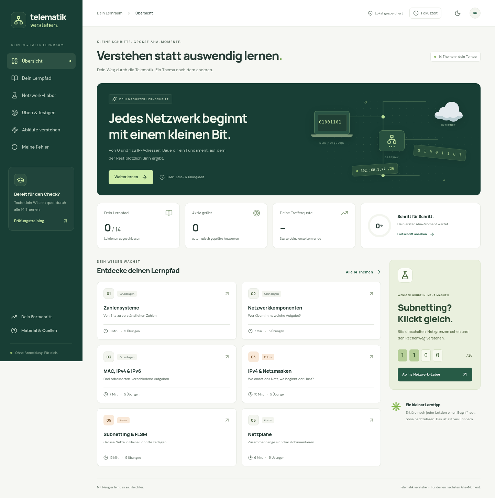

<div align="center">

# Telematik verstehen

**Verstehen statt auswendig lernen.**

Ein desktoporientierter Lernraum für Netzwerkgrundlagen, IPv4 und Subnetting – mit interaktiven Trainern, Übungen und lokal gespeichertem Fortschritt.


</div>



## Was du damit machen kannst

- **14 Themen lernen:** Von Zahlensystemen und Netzwerkgeräten über DNS, DHCP und Routing bis WLAN, NAT und Fehlersuche.
- **IPv4 verstehen:** Adressen, Masken und Bits live verändern; Netzadresse, Broadcast und Hostbereich nachvollziehen. `/31` und `/32` werden als Sonderfälle behandelt.
- **Selbst ausprobieren:** Binärtrainer, beidseitiger Netzvergleich und FLSM-Aufteilung.
- **Aktiv üben:** 70 feste Fragen, neu generierte Subnetting-Aufgaben, Hinweise, begründetes Feedback und Fehlerwiederholung.
- **Prüfungstraining machen:** Eine gemischte Runde mit einer Frage pro Thema und anschliessender Auswertung.
- **Zusammenhänge sehen:** Schrittweise Abläufe für DHCP, DNS, Routing, NAT/PAT und einen Websiteaufruf.
- **Fortschritt behalten:** Speicherung im Browser, JSON-Sicherung und Import. Hell-/Dunkelmodus, Tastaturbedienung und ein optionaler Fokus-Timer.

Keine Anmeldung, API-Schlüssel, Abos oder laufenden Serverkosten. Die Anwendung lädt keine externen Schriften oder Video-Player; Quellen und Videos öffnen nur nach einem Klick.

## Schnell starten

Installiere eine aktuelle **Node.js-LTS-Version** (mindestens 20.19; Node 22 empfohlen). Öffne ein Terminal im Projektordner:

```sh
npm ci
npm run dev
```

Öffne die im Terminal angezeigte lokale Adresse. Mit `Ctrl+C` beendest du den Entwicklungsserver.

### Ohne Entwicklungswerkzeuge lernen

```sh
npm run build
```

Danach kannst du **`dist/index.html` per Doppelklick öffnen** oder diese Datei weitergeben. Das fertige Lernprogramm ist in einer HTML-Datei gebündelt. Externe Quellen/Videos benötigen weiterhin Internet. Der Fortschritt bleibt pro Browser und Speicherort getrennt; nutze den Export für Sicherungen und zum Übertragen.

Bei erfolgreichen GitHub-Actions-Läufen wird der fertige Build ausserdem als Download-Artefakt `Telematik-verstehen-offline` bereitgestellt. Das ist kein automatisch veröffentlichtes Webhosting.

## Bearbeiten und erweitern

Du musst nicht die gesamte Anwendung kennen, um Inhalte zu ergänzen:

| Du möchtest …                       | Dann bearbeite …     |
| ----------------------------------- | -------------------- |
| Eine Lektion oder Quizfrage ändern  | `src/content.ts`     |
| Eine IPv4-Berechnung ändern         | `src/network.ts`     |
| Einen Netzwerkablauf erklären       | `src/simulations.ts` |
| Farben, Abstände oder Layout ändern | `src/styles.css`     |
| Navigation oder Dashboard erweitern | `src/App.tsx`        |

Ein ausführlicherer Überblick steht in [docs/HANDOFF.md](docs/HANDOFF.md). Entstanden als gemeinsam geplantes, KI-unterstützt entwickeltes Lern- und Portfolio-Projekt.

## Qualität prüfen

```sh
npm test
npm run build
npx playwright install chromium
npm run test:e2e
```

Die IPv4-Tests verwenden unabhängige Referenzwerte aus Pythons `ipaddress`-Modul für jeden Präfix von `/0` bis `/32`. Browserprüfungen testen Lernabläufe, Quiz, Fortschritt, beide Farbschemata und automatisierte Accessibility-Regeln. GitHub Actions führt Build und Tests bei Pushes und Pull Requests aus.

```sh
npm run format        # Quelltext formatieren
npm run format:check  # Formatierung prüfen
```

## Quellen & Grenzen

Basis ist das bereitgestellte **Telematik-Lernskript (21 Seiten, 15. Oktober 2026)**, inklusive der fachlichen Präzisierungen auf Seite 20. Die 14 Originalhandouts mit 164 Seiten wurden nicht bereitgestellt; die Anwendung behauptet deshalb keine unabhängig geprüfte vollständige Abdeckung dieser Originale. Die Quellenübersicht in der App enthält offizielle Referenzen und Video-Links aus dem Skript. Aktuelle Videoverfügbarkeit wurde nicht verifiziert.

Freie Erklärfragen sind als **Selbstkontrolle** gekennzeichnet. Die Website behauptet keine zuverlässige automatische Bewertung freier Texte. Der Lernfortschritt wird weder synchronisiert noch an einen Server gesendet. Bei gesperrtem Browserspeicher informiert die Anwendung über das Problem.

Ein privates Bildungsprojekt, kein offizielles Angebot von BBC oder Moodle. Eine mögliche spätere Integration in «BBC Moodle Hilfe» ist noch nicht umgesetzt. Unterrichtsmaterialien sollten nur mit den erforderlichen Rechten weitergegeben werden; die Original-PDFs sind nicht im Repository enthalten.
